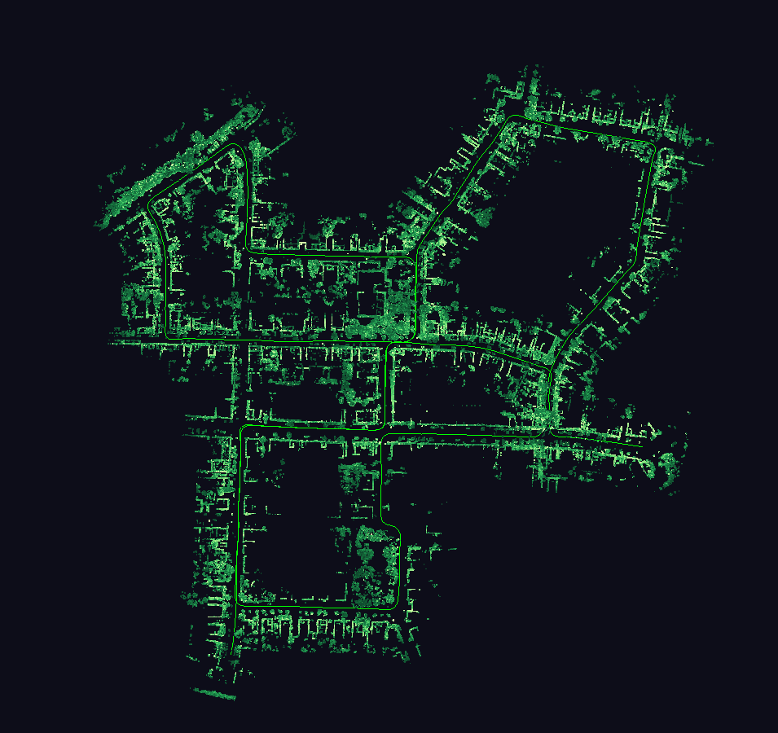
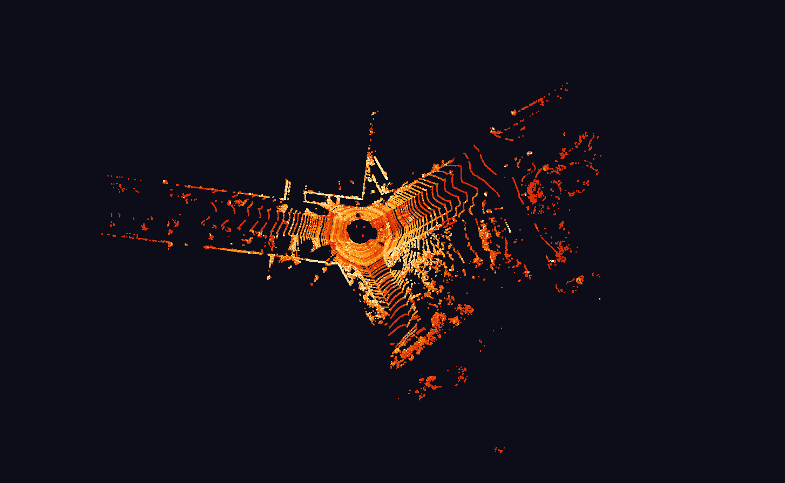
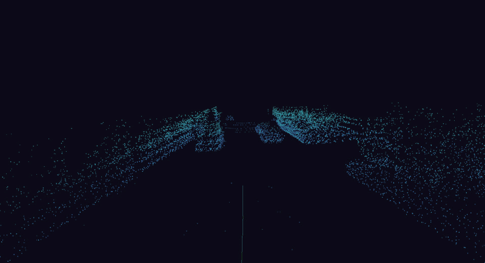
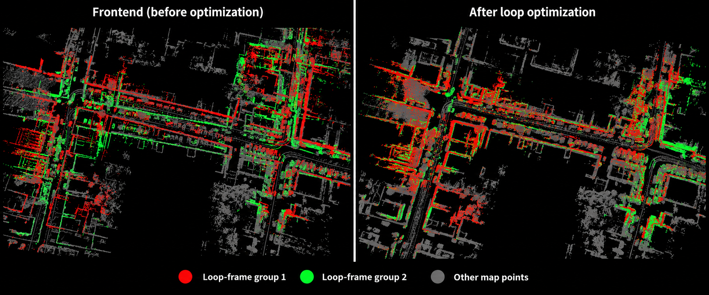
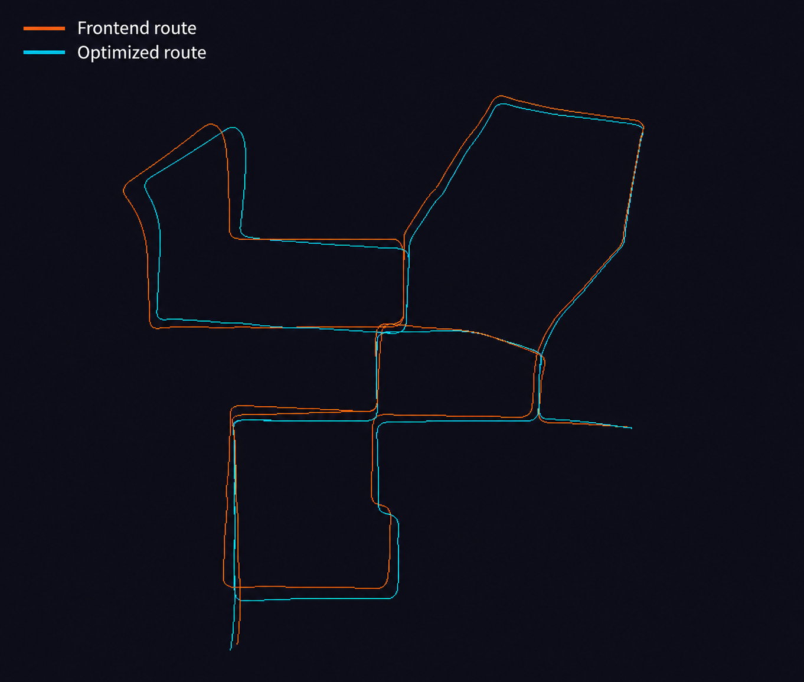
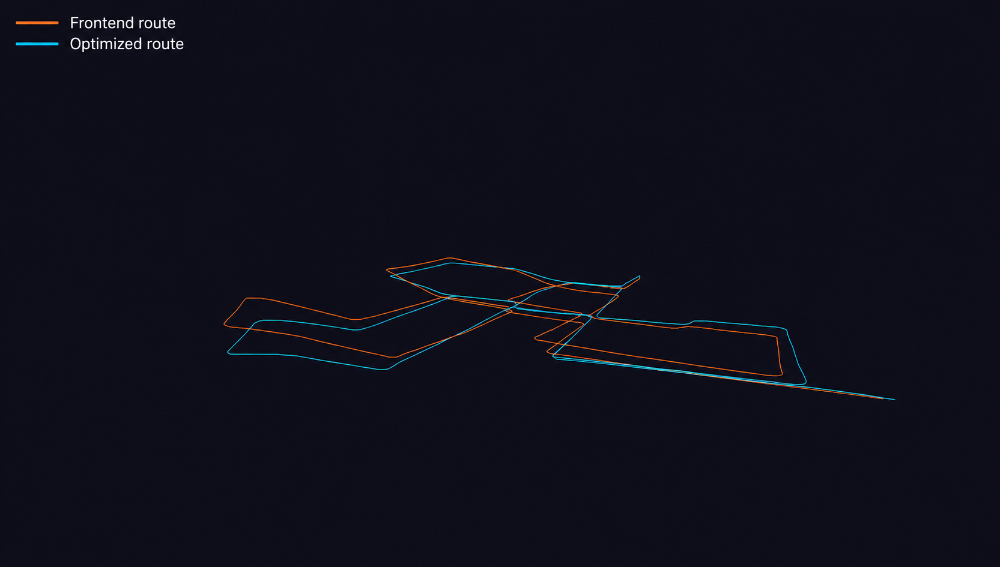
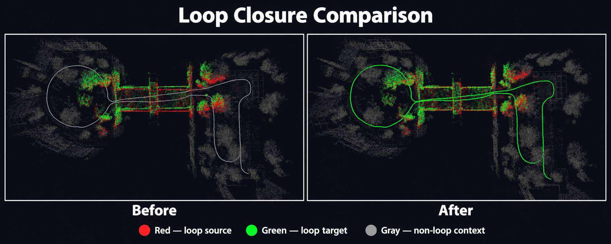
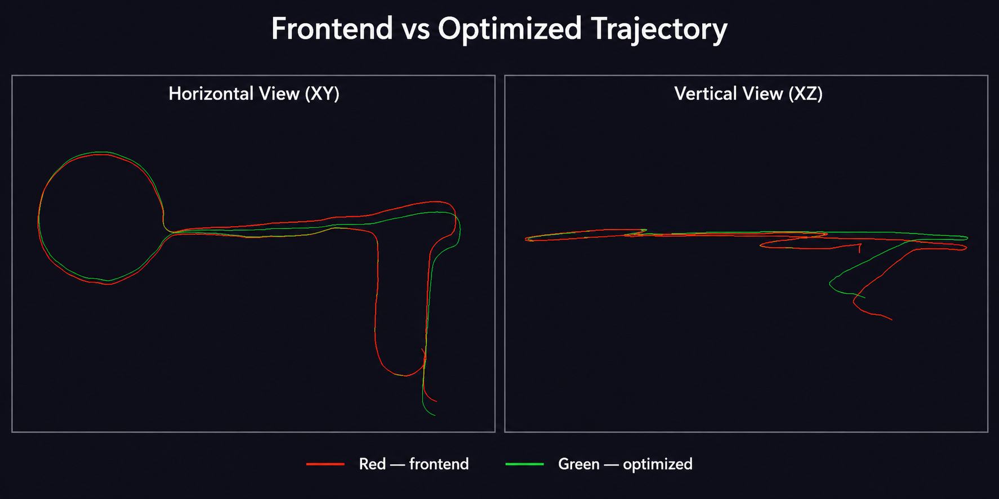
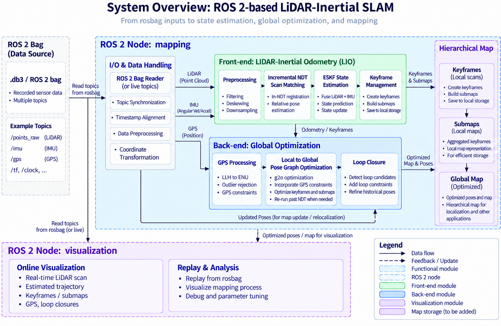
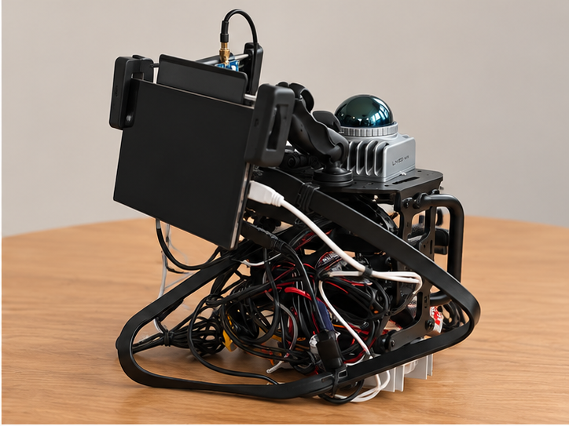

# LiDAR-Inertial SLAM System

A ROS 2 LiDAR-inertial SLAM system combining incremental Normal Distributions Transform (IncNDT) scan registration with an Error-State Kalman Filter (ESKF). A g2o backend incorporates GPS/RTK observations and loop closures to reduce accumulated drift and improve global consistency.

The map is organized into keyframes, submaps, and a global map. An OpenGL viewer displays point clouds and trajectories during mapping, replay, and optimization. The current workflow processes recorded ROS 2 bags offline.

## Demos

KITTI `2011_10_03_drive_0027`: optimized map, LiDAR visualization, and frontend/backend comparisons.

### Optimized map — top view



### LiDAR views

| Single LiDAR scan | Driving view |
| --- | --- |
|  |  |

### Loop-closure comparison

Frontend on the left; after optimization on the right. Red and green identify the two saved loop-frame groups; gray shows the surrounding map.



### Route comparison

Orange shows the frontend route; cyan shows the optimized route. The second view makes vertical differences visible.

| Route overview | Z-direction view |
| --- | --- |
|  |  |

### Garden loop-closure comparison

<p align="center">
  
  <br>
  <em>Garden loop-closure regions before and after optimization. Red and green identify the paired loop observations; gray provides non-loop context.</em>
</p>

### Garden route comparison

<p align="center">
  
  <br>
  <em>Garden frontend (red) and optimized (green) trajectories in horizontal and vertical views.</em>
</p>

## System architecture



`mapping_node` runs the front end or back end and publishes keyframe metadata through `lio_msgs/FrameData`. `opengl_vis_node` loads the saved clouds and renders the selected pose layers.

## Technical details

The pipeline combines point-cloud preprocessing, incremental scan registration, LiDAR–IMU fusion, keyframe and submap management, GPS alignment, and global pose graph optimization.

### 1. Point cloud preprocessing

**Voxel downsampling.** Each input point is assigned to a spatial voxel. Points in the same voxel are replaced by their centroid, reducing point-cloud density while preserving the scene's overall geometry.

**Geometric filtering.** Before scan matching, the current implementation retains points with X and Y within ±40 m and Z between −1 m and 5 m.

### 2. Incremental NDT — scan registration and local-map update

#### Voxel map

The local map is divided into fixed-size voxels. Each sufficiently populated voxel stores the mean $\mu$ and covariance $\Sigma$ of its points. The inverse covariance acts as an information matrix, weighting registration errors according to local geometry.

#### Scan registration

Starting from an initial pose $(R,t)$, a source point $p$ is transformed into the map frame. The corresponding voxel and, optionally, its six neighboring voxels provide candidate associations:

$$
q = Rp+t, \qquad e=q-\mu, \qquad E=e^T\Sigma^{-1}e.
$$

Associations whose Mahalanobis error $E$ exceeds the outlier threshold are rejected.

#### Gauss–Newton optimization

Registration estimates a six-dimensional pose correction. For the ordering $\Delta x=[\Delta\theta^T,\Delta t^T]^T$, the implementation uses:

$$
J=\begin{bmatrix}-R[p]_\times & R\end{bmatrix}.
$$

Valid associations contribute to the normal equations:

$$
H=\sum J^T\Sigma^{-1}J, \qquad
b=-\sum J^T\Sigma^{-1}e, \qquad
H\Delta x=b.
$$

The correction updates the pose on SE(3). Association and optimization repeat until the correction falls below the convergence threshold or the iteration limit is reached.

#### Incremental map update

After registration, the aligned scan is inserted into the local map. Only affected voxels have their statistics updated. Small covariance singular values are clamped before inversion for numerical stability, and a fixed-capacity LRU cache bounds the active voxel map.

### 3. ESKF sensor fusion — LiDAR–IMU state estimation

The Error-State Kalman Filter combines high-frequency IMU propagation with pose corrections from NDT registration. Its nominal state contains position, velocity, orientation, accelerometer bias, gyroscope bias, and gravity:

$$
x=\{p,v,R,b_a,b_g,g\}, \qquad
\delta x=[\delta p^T,\delta v^T,\delta\theta^T,\delta b_a^T,\delta b_g^T,\delta g^T]^T.
$$

The error state has 18 dimensions.

#### IMU prediction

Bias-corrected measurements $\hat a=a_m-b_a$ and $\hat\omega=\omega_m-b_g$ propagate the nominal state over a time step $\Delta t$:

$$
\begin{aligned}
R_{k+1} &= R_k\mathrm{Exp}(\hat\omega\Delta t), \\
v_{k+1} &= v_k+(R_k\hat a+g)\Delta t, \\
p_{k+1} &= p_k+v_k\Delta t+\tfrac12(R_k\hat a+g)\Delta t^2.
\end{aligned}
$$

The covariance is propagated using the linearized error dynamics and process noise.

#### LiDAR correction and error reset

The registered LiDAR pose is compared with the predicted pose to form a position and orientation residual $r$. With measurement Jacobian $H$ and measurement-noise covariance $R_m$, the Kalman update is:

$$
K=P^-H^T(HP^-H^T+R_m)^{-1}, \qquad \delta x=Kr.
$$

Position, velocity, biases, and gravity receive additive corrections; orientation receives a rotation correction through $R\leftarrow R\mathrm{Exp}(\delta\theta)$. The filter updates the covariance and resets the error state around zero before the next prediction cycle.

### 4. Keyframe and submap management

Translation and rotation thresholds select keyframes from the estimated trajectory. Keyframe point clouds and pose metadata are saved locally, then grouped into submaps for back-end registration and optimization. This hierarchy supports map management at keyframe, submap, and global-map levels.

### 5. GPS integration — coordinate conversion and route alignment

GDAL projects GPS/RTK latitude and longitude into UTM coordinates. A robust planar rigid transform aligns the local odometry trajectory with the GPS/RTK route, estimating yaw and XY translation separately from the vertical offset.

#### Planar alignment

Paired odometry and GPS/RTK positions are centered. SVD of their cross-covariance estimates the planar rotation, with translation recovered from the trajectory centroids:

$$
p_{xy}^{\mathrm{gps}}=R_{xy}p_{xy}^{\mathrm{odom}}+t_{xy}.
$$

#### Robust refinement and height alignment

A minimum-motion threshold removes spatially redundant correspondences. Alignment residuals identify outliers; the transform is re-estimated from the remaining inliers. The vertical offset is the median paired height difference:

$$
\Delta z=\mathrm{median}_i(z_i^{\mathrm{gps}}-z_i^{\mathrm{odom}}).
$$

The aligned GPS observations provide global position constraints for the back end.

### 6. Pose graph optimization and loop closure

Each keyframe is a pose vertex $X_i\in SE(3)$. The g2o graph combines three constraint types:

- **Odometry:** relative transformations between consecutive keyframes.
- **GPS:** global position observations associated with keyframes.
- **Loop closure:** relative transformations between revisited keyframes.

#### Loop candidate validation

Spatial proximity identifies potential revisits. A local sliding-window search evaluates nearby keyframe pairs using NDT registration, and a validated pair supplies an additional loop-closure edge.

#### Global optimization

The graph minimizes weighted residuals across the odometry, GPS, and loop constraints:

$$
X^*=\arg\min_X\sum_{c\in\mathcal C}\rho(e_c^T\Omega_c e_c),
$$

where $\mathcal C$ is the constraint set, $e_c$ is a constraint residual, $\Omega_c$ is its information matrix, and $\rho$ denotes a Huber robust kernel. Levenberg–Marquardt optimization adjusts the keyframe poses to reduce accumulated drift and improve global consistency.

## Dataset and evaluation

### Datasets

The custom `garden_rewrite` recording was collected with the portable mapping
platform shown below. The ROS 2 bag contains Livox LiDAR, IMU, and GPS streams
over an approximately four-minute run.

The KITTI comparison uses ROS 2 bag directory `data`, containing raw sequence
`2011_10_03_drive_0027`, and its complete saved mapping output. The table
distinguishes raw bag message counts from the keyframes used by evaluation.

<p align="center">
  
  <br>
  <em>Portable mapping platform used to record the garden dataset.</em>
</p>

| Dataset statistic | Garden | KITTI |
| --- | ---: | ---: |
| ROS bag directory | `garden_rewrite` | `data` |
| Recording/sequence | Garden recording | `2011_10_03_drive_0027` |
| ROS bag size | 1.2 GiB | 9.1 GiB |
| Raw recording duration | 239.51 s | 471.536 s |
| Raw LiDAR frames | 2,380 | 4,548 |
| Raw IMU messages | 22,574 | 45,700 |
| Raw GPS messages | 1,969 | 45,700 |
| Saved keyframes / available clouds | 2,055 / 2,055 | 2,239 / 2,239 |
| Evaluated trajectory duration | 232.50 s | 403.84 s |
| Optimized trajectory travel length | 202.81 m | 3,076.73 m |
| Accepted loop constraints | 4 | 12 |

### Evaluation framework

The standalone `evaluate_experiment` entry point evaluates completed mapping
artifacts without starting `mapping_node` or changing saved poses and maps. The
garden and KITTI experiments share the following metrics; fixed-map
localization is currently garden-only.

| Evaluation area | Metrics | Better direction | Garden | KITTI | Output |
| --- | --- | --- | :---: | :---: | --- |
| Trajectory geometry | Path length, endpoint displacement, horizontal endpoint displacement, and X/Y span | Descriptive | ✓ | ✓ | `trajectory_summary.csv` |
| Vertical drift | Signed start-to-end Z drift, minimum/maximum Z, and total Z range | Smaller when elevation should be unchanged | ✓ | ✓ | `trajectory_summary.csv` |
| Adjacent-cloud consistency | NDT score/chi-squared and valid-point coverage | Lower score and higher coverage | ✓ | ✓ | `cloud_alignment.csv`, `summary.csv` |
| Loop-closure consistency | Translation and rotation residuals against accepted loop measurements | Lower | ✓ | ✓ | `loop_residuals.csv`, `summary.csv` |
| Revisited-wall consistency | Central 80% wall-surface thickness across observations separated by at least 30 seconds | Lower | ✓ | ✓ where walls exist | `wall_thickness.csv`, `summary.csv` |
| Wall-plane quality | Point-to-plane RMSE for the same revisited wall cells | Lower | ✓ | ✓ where walls exist | `wall_thickness.csv`, `summary.csv` |
| GNSS agreement | Horizontal, absolute vertical, and 3D position errors | Lower | Optional | Optional | `gps.csv`, `summary.csv` |
| Fixed-map localization | Registration coverage, inlier RMSE, correction distance/angle, acceptance rate, and processing time | Higher coverage/acceptance and lower error/correction | ✓ | Not currently used | `localization.csv` |
| Route export | TUM trajectories for plotting or external tools | Descriptive | ✓ | ✓ | `frontend.tum`, `loop.tum` |

### Garden and KITTI evaluation results

Both datasets use the same two-stage comparison: saved frontend poses versus
final loop-optimized poses. Garden wall statistics cover 75 symmetrically
selected revisit cells; KITTI uses 415 cells selected in the final loop-map
frame because its large initial drift prevents repeated surfaces from sharing
unbiased spatial cells. Both stages within each dataset evaluate identical
LiDAR point identities.

| Metric | Garden frontend | Garden optimized | KITTI frontend | KITTI optimized |
| --- | ---: | ---: | ---: | ---: |
| Endpoint Z-drift magnitude | 1.868 m | 0.724 m | 0.541 m | 2.797 m |
| Z range | 2.710 m | 2.535 m | 34.676 m | 4.322 m |
| Accepted-loop translation RMSE ↓ | 0.912 m | 0.133 m | 10.618 m | 0.713 m |
| Accepted-loop rotation RMSE ↓ | 2.794° | 2.369° | 3.457° | 3.080° |
| Adjacent-cloud valid-point coverage ↑ | 79.85% | 79.83% | 90.41% | 89.78% |
| Cloud pairs with sufficient matches | 206 / 206 | 206 / 206 | 224 / 224 | 223 / 224 |
| Mean wall-surface thickness ↓ | 0.188 m | 0.129 m | 0.386 m | 0.171 m |
| Median wall-surface thickness ↓ | 0.152 m | 0.118 m | 0.372 m | 0.174 m |
| P95 wall-surface thickness ↓ | 0.475 m | 0.264 m | 0.716 m | 0.243 m |
| Mean wall-plane RMSE ↓ | 0.087 m | 0.058 m | 0.153 m | 0.072 m |

Wall-surface thickness is a map-consistency measurement of blurred or doubled
surfaces, not the physical construction thickness of a wall. Loop residuals
measure agreement with constraints used by optimization and are therefore not
independent accuracy measurements. GNSS metrics are valid only when the saved
trajectory and GNSS observations use the same coordinate frame.

The KITTI run produced a complete set of saved keyframe clouds over a 3.07 km
estimated route. Loop optimization reduced translation residual RMSE against 12
accepted loop measurements by **93.3%**, from 10.618 m at the frontend to
0.713 m. Sampled adjacent-cloud matching retained approximately **90% coverage**
after optimization. Cloud checks sample every tenth adjacent pair and use saved
relative poses without rerunning registration. One optimized pair has
insufficient matches. These are internal consistency checks, not independent
accuracy measurements.


## Main challenges

- **Limited motion compensation:** the draft's datasets lack per-point timestamps, preventing point-level LiDAR deskewing and leaving within-scan motion distortion.
- **Intermittent IMU data:** missing measurements weaken prediction, particularly during sharp turns and rapid orientation changes.
- **Parameter sensitivity:** NDT, keyframe selection, loop search, and graph weights require tuning across sensors and environments.
- **Weak vertical constraints:** street-driving geometry provides less Z-axis information, allowing vertical drift to accumulate.
- **Loosely coupled GPS correction:** GPS acts primarily through the back end, improving global consistency while front-end drift can still accumulate.

## Future work

- Fuse camera observations with the LiDAR-inertial pipeline.
- Associate fitted planes with meaningful objects and structures.
- Explore learned visual geometry, including VGGT, for reconstruction and correspondence.
- Remove dynamic objects before registration and map integration.

## Repository layout

```text
src/
├── lio_msgs/                  Custom keyframe visualization messages
└── lio_viz/
    ├── include/               Estimation, mapping, and visualization interfaces
    ├── src/
    │   ├── Config/            YAML configuration
    │   ├── io/                Offline ROS bag reader
    │   ├── Lio/               LiDAR–IMU processing pipeline
    │   └── Slam/              Front end, back end, and pose graph optimization
    ├── docs/                  Evaluation documentation
    └── test/                  Core and evaluation tests
